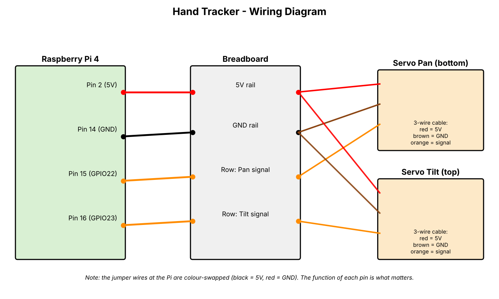

# Hand Tracker
 
<!-- TODO: Add a photo of your finished, built project here. -->
 
 
## What is this project?
 
I designed and assembled a hand that mimics the movements of my own hand using two servo motors, a Raspberry Pi, and a camera.
[Describe your project here.]
 
## How would it be used?
 
This project could help people with limited hand mobility by allowing them to control a robotic hand that mimics their own movements. It could also be used for research in robotics, computer vision, and human-machine interaction.
[Describe the use case here.]
 
## Why did I make it?
 
<!-- TODO: Write 1-2 sentences in your OWN words. What made you start this project? -->
[Write your motivation here.]
 
## Demo video
 
<!-- TODO: Upload to YouTube or Reddit. Google Drive / Mega links do NOT count. -->
https://javinwittig.github.io/hand_tracker_website/
 
## Devlogs
 
<!-- TODO: Link your devlogs of the physical build. -->
[Link to devlogs](TODO)
 
---
 
## Pictures
 
### 3D model
 
<!-- TODO: Screenshot of the full 3D model (e.g. the pan/tilt mount with camera). -->

 
### Wiring diagram
 
<!-- TODO: Add a wiring diagram (no PCB is used in this project). -->

 
### PCB
 
No PCB is used in this project. All connections are wired directly to the Raspberry Pi GPIO header.
 
---
 
## How it works
 
A camera is mounted on a Raspberry Pi and streams video to a PC. The PC tracks the hand with MediaPipe and sends target angles back to the Pi, which drives two servo motors (pan/tilt) to follow the hand.
 
```
Camera -> Raspberry Pi --(JPEG via HTTP POST)--> PC (MediaPipe)
                       <--(JSON: found, angle_deg, roll_deg)--
Raspberry Pi -> 2 servos (pan / tilt)
```
 
1. **Camera pipeline:** `rpicam-vid` captures YUV420 at 640x480, 15 fps, rotated 180°.
2. **Streaming:** Each frame is encoded as JPEG and sent to the PC.
3. **Hand tracking:** MediaPipe HandLandmarker (Tasks API, `LIVE_STREAM` mode) detects the hand.
4. **Coordinate transmission:** The PC returns `found`, `angle_deg` and `roll_deg` as JSON.
5. **Servo control:** The Pi converts the angles to PWM duty cycles and moves the servos smoothly.
6. **Live preview:** A local Flask website shows an MJPEG live stream.
## Repositories
 
| Part | Link |
|---|---|
| Pi client (this repo) | `main.py`, `servo.py` |
| Tracking server (PC) | https://github.com/javinwittig/hantracking_server |
| Project website | https://javinwittig.github.io/hand_tracker_website/ |
| Website source | https://github.com/javinwittig/hand_tracker_website |
 
---
 
## Requirements
 
### Hardware
 
| Component | Requirement |
|---|---|
| Single-board computer | Raspberry Pi 4 (4 GB) running Raspberry Pi OS |
| Camera | Raspberry Pi camera module (must work with `rpicam-vid`) |
| Servos | 2x SG90-class servo (pan and tilt) |
| PC | Computer with a capable GPU (developed on an RTX 5070) |
| Network | Pi and PC on the same network |
| Power | Pi power supply; a separate 5 V supply for the servos is recommended |
 
### Servo wiring
 
- Pin mode: `BOARD` (physical pin numbers)
- Servo signal wires on **pin 15** and **pin 16**
- PWM frequency: 50 Hz
- Duty cycle: 2.5 (-90°), 7.5 (0°), 12.5 (+90°)
### Software on the Raspberry Pi
 
- Raspberry Pi OS, Python 3, `rpicam-vid` (from `rpicam-apps`)
- Python packages (see `requirements.txt`): `opencv-python`, `numpy`, `requests`, `RPi.GPIO`, `python-dotenv`
```bash
python3 -m venv --system-site-packages .venv
source .venv/bin/activate
pip install -r requirements.txt
```
 
### Software on the PC
 
- Python 3, MediaPipe (HandLandmarker), Flask
- See the `requirements.txt` of the [tracking server repo](https://github.com/javinwittig/hantracking_server)
### Configuration
 
Create a `.env` file in the project folder (it is git-ignored):
 
```
SERVER_URL=http://<PC-IP>:<port>/<path>
```
 
---
 
## Run it
 
1. Start the tracking server on the PC.
2. Create the `.env` file on the Pi with the server URL.
3. Optional servo test: `python servo.py`
4. Start tracking: `python main.py` (stop with `Ctrl+C`)
## Notes
 
- Frames that are too dark (mean brightness < 25) are skipped, so use good lighting.
- Adjust `PAN_ANGLE_RANGE`, `TILT_ANGLE_RANGE` and `SMOOTHING` in `main.py` to your setup.
## AI usage
 
Claude for some coding and research, and OpenCode.
